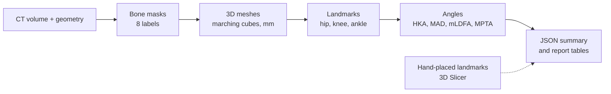

# FemuraLabs

**Open-source lower-limb CT analysis: segmentation, 3D meshes, anatomical landmarks, alignment angles, and a validation report that states its own limits.**


> [!WARNING]
> FemuraLabs is a research prototype. It is not a medical device and must not be used for diagnosis or treatment planning.

| Segmentation | Landmarks | Alignment |
|---|---|---|
| **0.922 ± 0.051** Dice<br/><sub>8 subjects, 4-fold CV</sub> | **2.6–6.9 mm** from hand reference<br/><sub>6 clean subjects</sub> | **0.98°** mean HKA error<br/><sub>6 clean subjects, coronal</sub> |

[Documentation](https://sashminea.github.io/FemuraLabs/) · [HTO simulator](https://sashminea.github.io/FemuraLabs/simulator/) · [Kaggle notebook](https://www.kaggle.com/code/sashmin/femuralabs) · [Validation report](reports/validation.md)

---

## Contents

- [Overview](#overview)
- [What sets it apart](#what-sets-it-apart)
- [Pipeline](#pipeline)
- [Quickstart](#quickstart)
- [Results](#results)
- [Reproducing the validation](#reproducing-the-validation)
- [Training the segmentation model](#training-the-segmentation-model)
- [Repository layout](#repository-layout)
- [Documentation](#documentation)
- [Limitations](#limitations)
- [Citation, data and licences](#citation-data-and-licences)
- [Author](#author)

---

## Overview

Lower-limb malalignment shifts load onto one side of the knee and is a major driver of osteoarthritis. Surgeons planning a correction, such as a high tibial osteotomy (HTO), need to know how far a limb deviates from a straight mechanical axis. The best-known measure is the hip-knee-ankle (HKA) angle. Today these measurements are mostly made by clicking points on images by hand, which is slow and varies between observers.

FemuraLabs automates the geometric part of that work. Given a CT volume it:

1. segments the femur, tibia, fibula and talus;
2. reconstructs each bone as a watertight 3D mesh in physical millimetres;
3. locates the hip, knee and ankle centres from mesh geometry;
4. computes HKA, MAD, mLDFA and MPTA;
5. compares every automatic result with landmarks placed by hand in 3D Slicer.

## What sets it apart

- **Validated against a human, not only a Dice score.** Each automatic landmark is compared with a hand click on the same subject, and the hand-placement repeat distance is reported next to it so the error can be read against the noise floor of the reference.
- **Cross-validated segmentation.** A 4.7M-parameter 3D SegResNet (MONAI), trained from scratch, was evaluated with 4-fold cross-validation so every subject was held out once. Checkpoints were selected on the validation folds, so reported Dice carries a small optimism bias (see [Limitations](#limitations)).
- **Protocol-aware comparison with TotalSegmentator.** The reference masks are hollow cortical shells, while TotalSegmentator predicts solid bone. The report shows both the raw and the interior-filled comparison and explains the gap.
- **Failures are reported, not hidden.** Two subjects fail because of metal implants and postmortem deformation. Results are shown for all 8 subjects and for the 6 clean ones.
- **Reproducible.** One CLI, one Docker image, generated report tables, and [52 decision records](docs/decisions.md), each with the alternative that was rejected.
- **Coordinate-safe by construction.** LPS vs RAS and left vs right errors fail silently in medical imaging. Sides and geometry are pinned by tests.

## Pipeline



Everything lives in one frame: **LPS millimetres**, the frame SimpleITK uses. Voxel spacing, origin and direction travel with the array, so every number downstream is physical.

| Landmark | Automatic rule |
|---|---|
| Femoral head | Least-squares sphere fit to the medial 20 mm of the proximal 25% of the femur, with iterative outlier trimming. A radius outside 17–25 mm flags a bad fit. |
| Knee centre | Bounding box of a 2 mm axial slab 15 mm above the lowest femoral vertex, shifted by fitted lateral and anterior offsets. Robust to one condyle sitting lower than the other. The offsets are a fitted convention, not a notch detector. |
| Ankle centre | Tibial plafond located as the widest band in the distal tibia, then the midpoint of the medial tibial edge and lateral fibular edge at that level. |

HKA is computed in the **coronal plane**, matching the clinical definition and the plane used for mLDFA and MPTA. It is signed: positive is varus, negative is valgus, and the side is detected automatically. The 3D angle is kept in the JSON as `HKA3D_{side}`. mLDFA and MPTA are reported as acute angles (90° or less).

## Quickstart

No data download is needed to install the tool and run the tests.

```bash
git clone https://github.com/sashminea/FemuraLabs.git
cd FemuraLabs

python3 -m venv .venv
source .venv/bin/activate        # Windows: .venv\Scripts\Activate.ps1
pip install -r requirements.txt
pip install -e .

femuralabs doctor check
pytest -q
```

Docker runs the geometry pipeline on a built-in synthetic eight-bone volume:

```bash
docker build -t femuralabs-tool .
docker run --rm femuralabs-tool
```

To process real data, mount it read-only and write to a mounted output folder:

```bash
docker run --rm \
  -v "$(pwd)/data:/data:ro" \
  -v "$(pwd)/output:/output" \
  femuralabs-tool \
  python scripts/pipeline/pipeline_demo.py \
    --case /data/raw/case01/combined_seg.nii \
    --out /output/case01
```

## Results

All results come from **8 cadaveric subjects** of the [VSDFullBodyBoneReconstruction](https://doi.org/10.5281/zenodo.8302449) dataset, compared with hand-placed landmarks from a single annotator. Case 04 (postmortem deformation) and case 06 (bilateral implants) are reported separately because their errors come from the artefacts, not from the rules.

### Landmarks

| Landmark | Mean error, clean 6 | Mean error, all 8 | Hand repeat (case01) |
|---|---|---|---|
| Femoral head | 2.6–2.7 mm | 6.5–9.7 mm | 4–6 mm |
| Knee centre | 4.3 mm | 4.9–5.3 mm | 3–5 mm |
| Ankle centre | 5.6–6.9 mm | 6.0–7.3 mm | ~2 mm |

The femoral head fit is inside the hand repeat distance on clean anatomy. The knee rule is comparable to it. The ankle rule is not: it sits at roughly twice the repeat distance because it uses the plafond as a proxy for the talar dome. Cases 04 and 06 fail at 26–36 mm on the femoral head.

### Alignment angles

| Angle | n | Mean abs error, all | Mean abs error, clean 6 |
|---|---|---|---|
| HKA right (coronal) | 8 | 1.65° | **0.98°** |
| HKA left (coronal) | 8 | 1.26° | **0.98°** |
| mLDFA right | 8 | 1.23° | 0.82° |
| MPTA right | 8 | 0.62° | 0.58° |

> [!NOTE]
> The joint-line points used for mLDFA and MPTA are the same hand clicks in both the automatic and the hand computation. The sub-degree agreement therefore validates the mechanical-axis contribution, not an automatic joint-line detector.

Per-case tables: [`reports/landmark_errors.md`](reports/landmark_errors.md), [`reports/angles_case.md`](reports/angles_case.md), [`reports/validation.md`](reports/validation.md).

### Segmentation: TotalSegmentator vs reference

The reference masks trace only the cortical shell. Filling the medullary canal before comparison (femur volume rises about 1.35×) is the protocol-correct test.

| Bone | Dice, filled reference | Dice, raw reference | HD95 (mm) |
|---|---|---|---|
| Femur | **0.94** | 0.72 | 2.8 |
| Tibia | **0.90** | 0.66 | 5.5 |
| Fibula | **0.82** | 0.73 | 2.5 |

TotalSegmentator was run at 3 mm on cropped CTs because its full-resolution resampling step exceeds the memory of the development machine. The gap between raw and filled Dice measures the annotation-protocol difference, not model error.

### Segmentation: SegResNet (4-fold cross-validation)

| Bone | Mean Dice | SD | Median HD95 |
|---|---|---|---|
| Femur | 0.94 | 0.06 | 1.50 mm |
| Tibia | 0.91 | 0.06 | 3.84 mm |
| Fibula | 0.91 | 0.04 | 1.50 mm |
| Talus | 0.92 | 0.03 | 2.69 mm |
| **Overall** | **0.922** | **0.051** | n/a |

Each fold trains on 6 subjects and validates on 2. Dice is comparable to TotalSegmentator on femur and tibia and higher on fibula, though the TotalSegmentator run is at lower resolution and has no talus result. The full run is a public [Kaggle notebook](https://www.kaggle.com/code/sashmin/femuralabs).

## Reproducing the validation

### 1. Prepare the segmentations

The dataset ships in inconsistent layouts, and both usable ones are automated. Subject-to-case mapping and the discarded split-volume subjects are in [`docs/data.md`](docs/data.md).

```bash
# Standard lower-limb subjects (case01-case03)
femuralabs data merge --thighs path/to/thighs.nii --shanks path/to/shanks.nii \
  --out data/raw/caseXX/combined_seg.nii

# Full-body, upside-down subjects (case04-case08)
femuralabs data preprocess \
  --ct path/to/SMIR.Body.nii \
  --thighs-seg path/to/Pelvis-Thighs.seg.nrrd \
  --shanks-seg path/to/Shanks-Feet.seg.nrrd \
  --transform path/to/Transform-Upside-Down.h5 \
  --out-dir data/raw/caseXX
```

For full-body subjects the H5 transform is applied mathematically in Python. Exporting from Slicer drops the transform and corrupts the geometry.

### 2. Place reference landmarks

Place ten landmarks per subject in 3D Slicer and save them as `data/ref/landmarks_caseXX.mrk.json`. The click-by-click guide and anatomical definitions are in [`docs/landmarks.md`](docs/landmarks.md).

### 3. Run the pipeline

```bash
femuralabs pipeline batch                    # all cases

femuralabs pipeline run \                    # one case
  --case data/raw/case07/combined_seg.nii \
  --out output/case07 \
  --compare data/ref/landmarks_case07.mrk.json \
  --angles --fill
```

Each case writes STL meshes and `output/<case>/summary.json`.

### 4. Generate the reports

```bash
femuralabs pipeline report
```

Tables are generated from the JSON summaries, never typed by hand.

## Training the segmentation model

The model predicts five classes (background, femur, tibia, fibula, talus). Left and right are merged during training, which allows flip augmentation, and are reconstructed at inference with connected components. Reference masks are interior-filled at native resolution before resampling to 1.5 mm isotropic.

```bash
femuralabs ml prepare --out-dir data/ml_npy

femuralabs ml train --data-dir data/ml_npy --out-dir runs/run1 \
  --patch 96 --batch-size 2 --epochs 200          # GPU required

femuralabs ml validate --checkpoint runs/run1/best.pt \
  --data-dir data/ml_npy --val-cases case07,case08
```

To segment a new scan with the released weights:

```bash
femuralabs ml download-weights
femuralabs ml infer --ct path/to/new_scan.nii --out data/raw/caseXX/combined_seg.nii
```

The output feeds directly into `femuralabs pipeline run`.

## Repository layout

```text
FemuraLabs/
├── src/femuralabs/
│   ├── cli/            # Typer CLI: data, pipeline, ml, doctor
│   └── toolkit/        # fileio, imaging, geometry, reporting, service, training
├── scripts/            # data prep, pipeline, ML, dev tooling
├── tests/              # pytest suite
├── docs/               # engineering and scientific documentation
├── reports/            # generated validation tables
├── web/                # Next.js documentation site and HTO simulator
├── Dockerfile          # tool image
└── CITATION.cff
```

## Documentation

| File | Contents |
|---|---|
| [`reports/validation.md`](reports/validation.md) | Full validation report and method limitations |
| [`docs/runbook.md`](docs/runbook.md) | Every command, Slicer workflow and diagnostic |
| [`docs/landmarks.md`](docs/landmarks.md) | Coordinate traps, placement guide, rules behind the automatic landmarks |
| [`docs/conventions.md`](docs/conventions.md) | LPS/RAS, landmark definitions, angle sign convention |
| [`docs/data.md`](docs/data.md) | Datasets, licences, label mappings, dataset traps |
| [`docs/decisions.md`](docs/decisions.md) | Design choices and rejected alternatives |
| [`docs/architecture.md`](docs/architecture.md) | Folder map and pipeline stages |
| [`docs/FLOW.md`](docs/FLOW.md) | Annotated call graphs |

## Limitations

This is descriptive evidence on a small dataset, not clinical validation.

**Data**
- Eight cadaveric subjects, scanned supine and postmortem, so geometry differs from a standing, weight-bearing patient.
- One annotator produced all reference landmarks.
- Reference masks are hollow cortical shells; the interior-filled comparison corrects for this.
- No external test set. Checkpoints were selected on the validation folds, so reported Dice may be slightly optimistic.

**Failure modes**
- Metal implants (case 06) cause beam hardening that fragments masks and breaks the femoral head fit (errors above 30 mm). Angles for that subject are invalid.
- Severe deformation (case 04) breaks the knee and ankle rules.

**Method**
- The ankle rule uses the tibial plafond as a proxy for the talar dome. The talus is segmented but not yet used.
- The knee offsets are fitted to the annotator's convention (leave-one-subject-out RMS about 5.1 mm in x).
- mLDFA and MPTA do not validate joint-line detection (see note above).
- The reference joint-line clicks repeat only to 7–9 mm.
- The TotalSegmentator comparison used 3 mm resolution.
- The SegResNet has only been tested on this dataset and should not be treated as a generalisable model until evaluated on external data.

**Not done:** image registration, DRR generation, X-ray or radiograph analysis, and osteotomy planning beyond the simulator.

## Citation, data and licences

If you use FemuraLabs, please credit the project and cite via [`CITATION.cff`](CITATION.cff):

> FemuraLabs, https://github.com/sashminea/FemuraLabs, Apache 2.0.

- **Code, model weights and documentation:** Apache License 2.0. Attribution is preserved through the [`NOTICE`](NOTICE) file. Commercial use is permitted.
- **Data:** not included and not covered by the code licence.
  - Segmentations and surface models: [Zenodo 8302449](https://doi.org/10.5281/zenodo.8302449), CC BY-NC-SA 4.0.
  - CT collection: [Zenodo 8270365](https://doi.org/10.5281/zenodo.8270365), CC BY-NC-SA 3.0 Switzerland.
