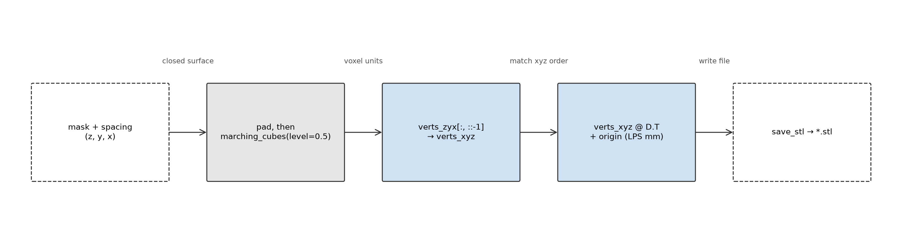
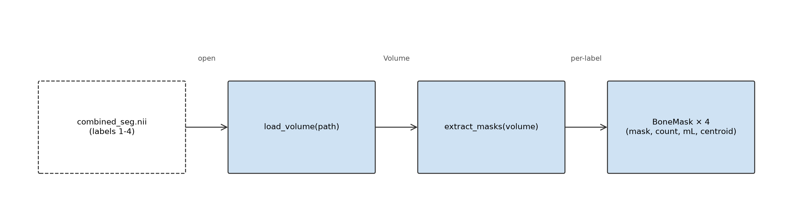
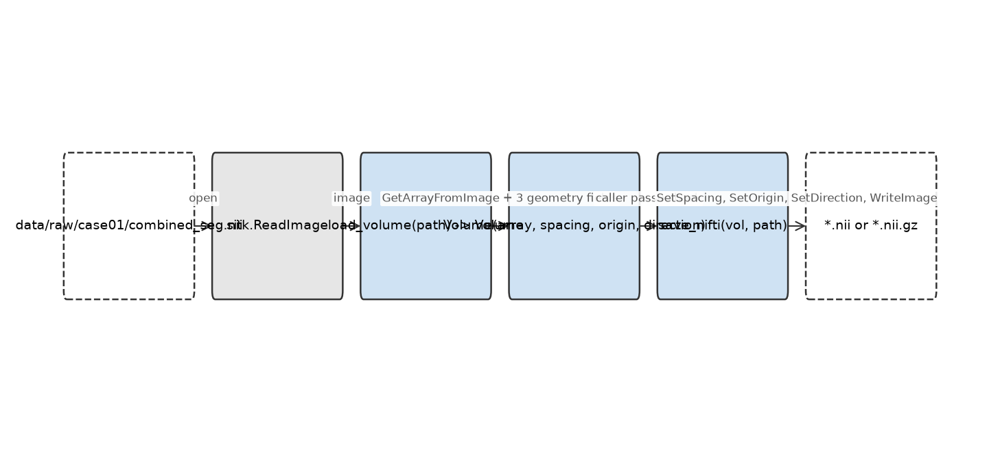
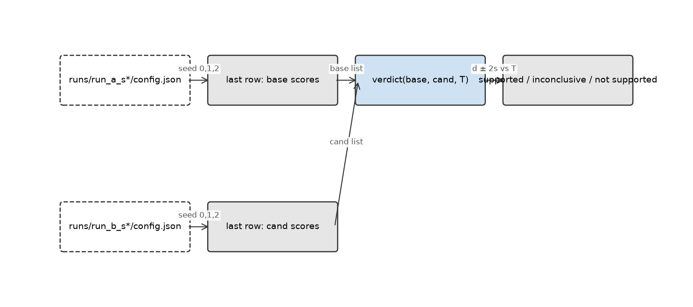
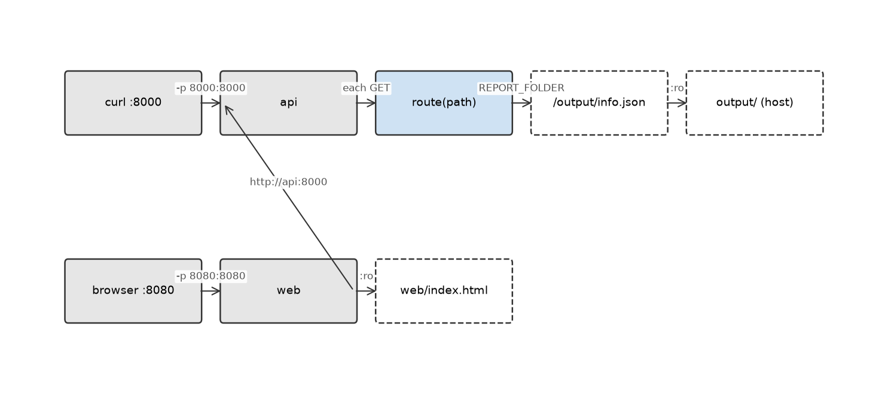
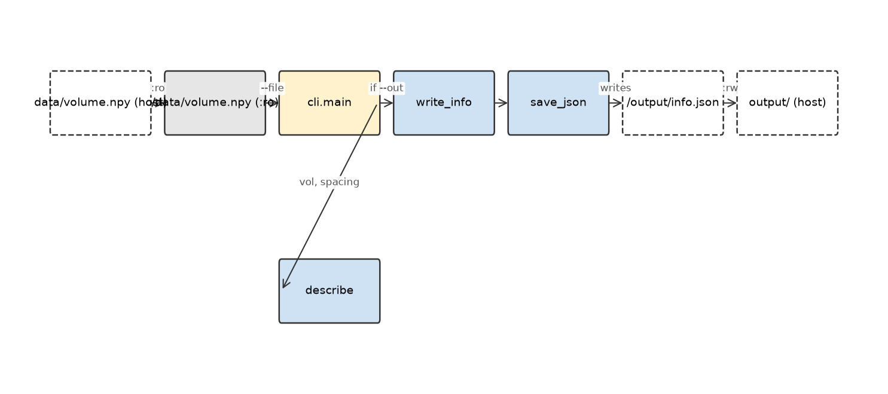
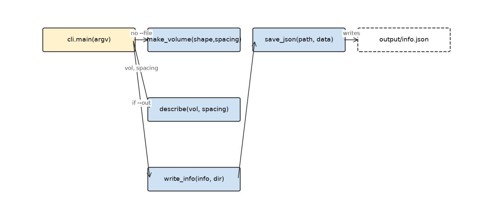

# Flow diagrams

A cumulative record of the module-level flow at each recorded point in the
project. Each section shows the functions involved, their parameters and
return values on the node labels, and the data that moves between them on
the arrows. This is an **annotated call graph**: a call graph where each
edge carries the data that flows across it.

Sections are **added at the top and never removed or edited**. If the code
changes shape later, the older diagram is still accurate for its point in
time; the current shape is the topmost section. This mirrors the
append-only convention of `decisions.md`.

Diagrams supplement the tests, they do not replace them. The tests under
`tests/` are the source of truth for behaviour; a diagram is a summary
that makes the wiring visible at a glance, and it cannot catch an error
path or an edge case.

To add a section, run `scripts/draw_flow.py` with a JSON specification on
stdin and a descriptive `--slug`. See `docs/RUNBOOK.md` for the exact
command.

Node colours: blue = module, green = script, yellow = CLI entry point,
white-dashed = file on disk, grey = external.

---

<!-- INSERT HERE -->

---

## Mask to mesh: marching cubes and world-space transform

mask_to_mesh pads the boolean mask with a one-voxel zero border so the surface closes at the mask boundary, then calls skimage's marching cubes at level 0.5 (the midpoint between 0 and 1, which is where the surface lies for a boolean mask) with spacing passed through so vertices come out in millimetre units. The vertices are returned in (z, y, x) order to match the array; reversing the columns gives (x, y, z) to match the spacing, origin and direction. Applying `verts_xyz @ D.T + origin` maps them into LPS world coordinates, which is what places the mesh on the CT in Slicer. Dropping either the reorder or the direction multiply leaves the mesh at the origin in the wrong orientation, and tests/test_mesh.py::test_femur_mesh_is_near_mask_centroid catches it by comparing the mesh centroid with the mask centroid.

---

## Extract per-bone masks, volumes and centroids

extract_masks walks the four label values written by the merge step (femur_R=1, femur_L=2, tibia_R=3, tibia_L=4) and returns a BoneMask per label containing a boolean mask, voxel count, volume in mL, and centroid in world coordinates. The centroid is the mean of the bone's voxel indices reordered from (z, y, x) to (x, y, z), then mapped with the same affine as load_volume carries: world = origin + direction @ (spacing * index). The reorder and the direction multiply are what make left/right signs correct in LPS; dropping either flips the femurs without raising an error, and tests/test_masks.py::test_left_right_are_on_correct_sides catches it.

---

## Volume I/O: read with geometry, save with geometry

load_volume calls sitk.ReadImage, then extracts the array plus the three geometry fields (spacing, origin, direction) into a Volume dataclass. The array is (z, y, x); the three geometry fields are (x, y, z), which is why the dataclass is the contract that pins the reversal. save_nifti rebuilds a SimpleITK image, re-applies the three fields, and writes NIfTI — without the three re-application calls, the file would carry default geometry (spacing 1 mm, origin 0, identity direction) and every downstream mesh would be wrong by the wrong scale.

---

## Verdict from per-seed metrics

Each variant is trained three times, one seed per run. Each run folder records the seed and the git commit in its config, so the folder is self-describing; the final row of its metrics.csv is that seed's score. Three baseline scores and three candidate scores feed verdict(base, cand, T). The function computes d = mean(cand) - mean(base) and s = max(stdev(base), stdev(cand)), then compares the interval d ± 2s with the threshold T. Three outcomes: supported if the whole interval is at or above T, not supported if entirely below, inconclusive otherwise. Lower-is-better metrics are handled by swapping the arguments at the call site.

---

## Compose: api and web on one network

docker compose up --build -d starts two containers on the project's private
network. curl reaches the api on host port 8000; a browser reaches the web
on host port 8080. The api service reads output/info.json from the :ro
mount, which is what /info returns when the file exists. From inside the
network, web reaches api by the service name http://api:8000/ and api
reaches web by http://web:8080/ — the names only resolve between containers,
not from the host. docker compose down removes both containers and the
network; the two bind-mounted folders survive on the host.

---

## Mounts: read-only data in, writable output out

Two host folders are mounted into the container: data/ read-only at /data,
and output/ writable at /output. The CLI reads /data/volume.npy, calls
describe and write_info, and save_json writes /output/info.json. Because
/output is a bind mount, the file the container sees at /output/info.json
is the host file output/info.json. The image holds neither folder.

---

## write_info and the --out flag

The geometry CLI branches on --file (load a .npy) and on --out (write
info.json). The writer lives in report.py and delegates the actual write to
io.save_json, which is also what training/train_utils.save_config uses. One
JSON writer, two public faces; the CLI never touches the file system
directly.

---